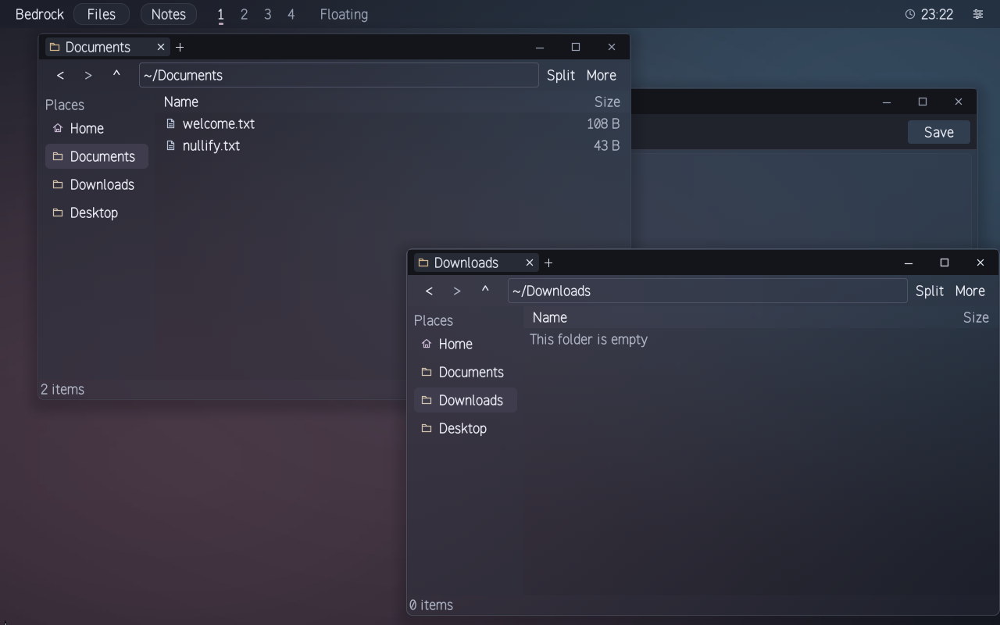
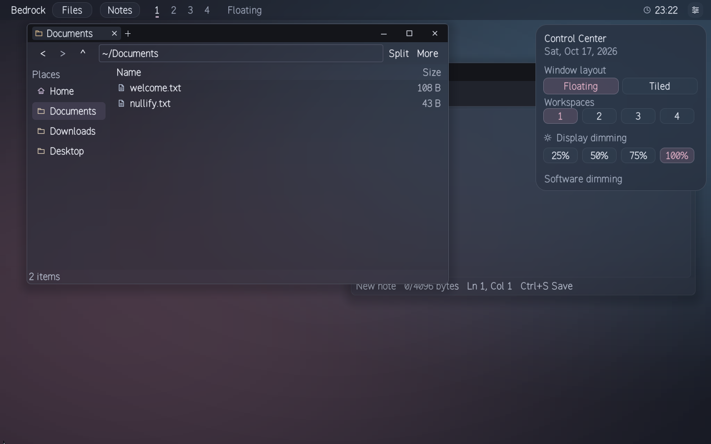
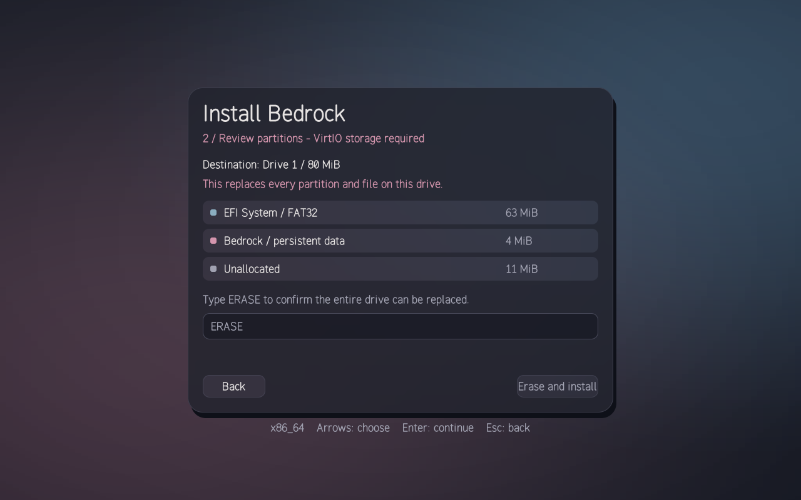

# Bedrock

An experimental operating system written in Zig, from its own bootloader and
kernel to a native desktop built with its own UI framework.

**x86-64 · ARM64 · RISC-V 64**

[Getting started](docs/getting-started.md) · [Architecture](docs/architecture.md) · [Roadmap](docs/roadmap.md)

*Files and Notes running as separate, protected native applications.*

## A desktop of its own

A Hyprland-inspired desktop with floating and tiled windows, four workspaces,
draggable folder tabs, editable file paths and configurable app menus. Tabs can
be reordered or pulled into their own windows, keeping their navigation history.
The system bar brings together launchers, the clock and Control Center.

[AxisUI](frameworks/public/AxisUI/README.md) renders the interface through native
declarative views, frosted materials, smooth vector icons and Bedrock's original
Axis Sans typeface.

[Anvil](docs/anvil.md) adds a graphics command framework with checked resources
and a working CPU framebuffer backend. Native GPU drivers and hardware
acceleration are the next graphics milestones.

## From boot to installation

Bedrock includes its own UEFI bootloader, kernel, preemptive processes,
capability-checked IPC and persistent storage. Apps have private containers and
read-only bundles.

The native installer provides drive selection, a partition preview, explicit
erase confirmation and verified installation. The installed system boots on
its own and keeps app data across reboots.

## Project status

Bedrock is a work in progress. The desktop and installer have been verified on
all three architectures in QEMU; the current installer requires VirtIO storage.
Physical hardware support is still being developed.

[Try Bedrock in QEMU](docs/getting-started.md#run-the-desktop) · [Installer guide](docs/installer.md) · [Support matrix](docs/support-matrix.md)
