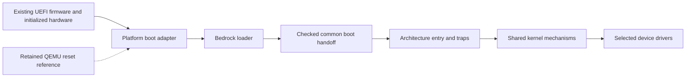

# Hardware portability

Bedrock uses shared Zig sources with three native architecture builds. A portable
kernel cannot infer RAM initialization, boot security, device registers or reset
wiring from the CPU instruction set alone. Support is tracked for named boot
environments and machines in the [support matrix](support-matrix.md).

UEFI is the primary boot path on x86-64, ARM64 and RV64. Existing firmware
initializes the board and RAM and loads Bedrock's own application; Bedrock owns
kernel loading, the checked handoff and OS execution after boot services exit.

The UEFI adapters allocate dynamic boot arenas, load relocatable kernels,
retain firmware maps/descriptions, and exit boot
services before entering their own kernel. x86-64 establishes sparse mappings
with explicit coverage and supports tested kernel placement above 4 GiB.
ARM64 normalizes firmware execution to EL1h; RV64 has a separate S-mode entry
and trap path alongside its reset M-mode path. Normal output uses a discovered
linear framebuffer or a supported ARM64/RV64 DTB UART. See the
[x86-64](x86_64-uefi.md) and [ARM64/RV64](arm64-riscv64-uefi.md) contracts.
Hardware-only Devicetree parsing permits GOP machines without a chosen UART;
full validation still retains static reservations and rejects malformed trees.

ARM64/RV64 share a bounded Devicetree parser that supports root memory banks
and both static reservation mechanisms. UART discovery supports chosen-console
aliases, identity bus mappings, PL011/16550 descriptions, fixed-clock providers
without argument cells and 8N1 settings. Multiple UART clocks must agree.
The parser uses up to 256 nodes, depth 32 and 64 banks/reservations; unsupported
memory/reservation layouts and exhausted capacities fail explicitly. Unsupported
UART bus translations or missing console clocks fail when serial discovery is
required.

The retained reset references use known linker arenas and discover memory sizes
and reservations. Their ARM64/RV64 loaders use this Devicetree parser; the PC
reset adapter consumes QEMU fw_cfg RAM/E820 records. These QEMU profiles keep
their documented startup assumptions and serve as regression targets.

## Porting sequence

1. Name the exact motherboard/SoC, UEFI firmware revision, architecture/ISA
   features and device set.
2. Qualify the firmware entry, initialized memory and application image access.
   Early board initialization remains the existing firmware's responsibility.
3. Produce the shared map, reservations, console and CPU-entry description.
   Preserve hardware/firmware data whose lifetime extends into the kernel.
4. Validate loader handoff and exception recovery on the real machine; then add
   interrupt/timer, storage and other required device drivers.
5. Repeat cold boots and recovery tests and record the supported firmware and
   hardware revisions. Keep the emulator acceptance matrix passing.

UEFI kernels now establish protected mappings, user entry and timer-preempted
saved contexts; see [the enforcement contract](protected-userspace.md) and
[timer profiles](preemptive-scheduling.md). Next shared work includes application
loading, expanded ACPI/Devicetree discovery, device drivers and physical qualification.
ACPI tables are retained but their device/controller descriptions are not yet
interpreted. RV64's current physical-address width is the named QEMU profile's
56-bit contract; general hardware needs a verified platform address/access
policy. Supporting a firmware standard broadens compatible systems; it does
not guarantee every device or every computer sharing an ISA.
